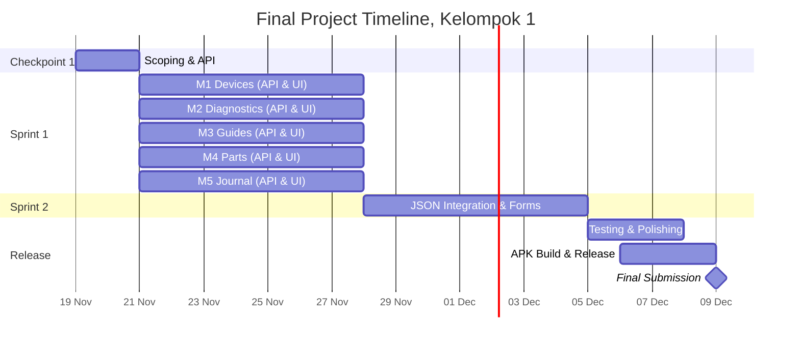

# Panduan Kolaborasi

## Timeline



## Alur kerja

1. Ambil terbaru: `git checkout main && git pull`
2. Buat branch dari `main`: `git checkout -b <tipe>/<modul>-<deskripsi-singkat>`
   - tipe: `feat`, `fix`, `chore`, `docs`
   - contoh: `feat/direktori-list-page`
3. Commit kecil dan sering. Format pesan: `feat(direktori): tambah halaman daftar suku cadang`
4. Push dan buka **Pull Request** ke `main`. Minta minimal **1 review** dari anggota lain.
5. CI harus hijau sebelum merge. Merge dengan **Squash and merge**.

**Jangan push langsung ke `main`.**

## Aturan

- Satu modul = satu folder di `lib/modules/<nama_modul>/`, dikerjakan satu pemilik. Hindari mengedit modul orang lain tanpa koordinasi.
- Kode bersama (tema, HTTP client, widget umum) ada di `lib/core/`. Perubahan di sini lewat PR kecil dan diinfokan ke grup.
- Dilarang meng-commit secret: keystore (`*.jks`, `key.properties`), `.env`, token. Sudah diblok `.gitignore`.
- Jangan hardcode URL API. Pakai `ApiConfig.baseUrl`.
- Jalankan `dart format .`, `flutter analyze`, `flutter test` sebelum push (CI mengecek hal yang sama).

## Rilis APK

```bash
git tag v1.0.0 && git push origin v1.0.0
```

Workflow `Release APK` membangun APK dan melampirkannya ke GitHub Release. Set repository variable `API_BASE_URL` (Settings → Secrets and variables → Actions → Variables) ke URL PWS produksi. APK juga wajib diunggah ke Bitrise (lihat brief tugas).
